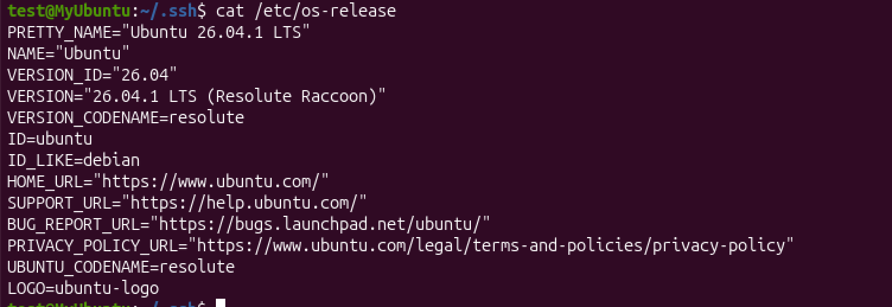
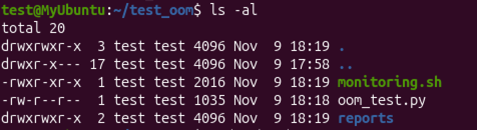
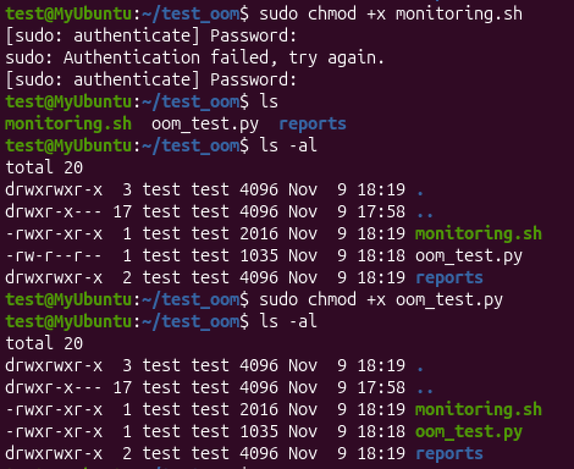
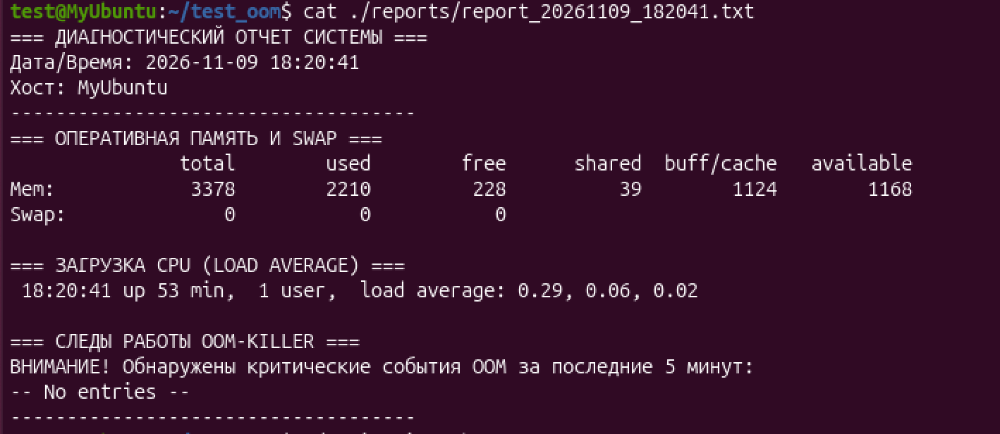
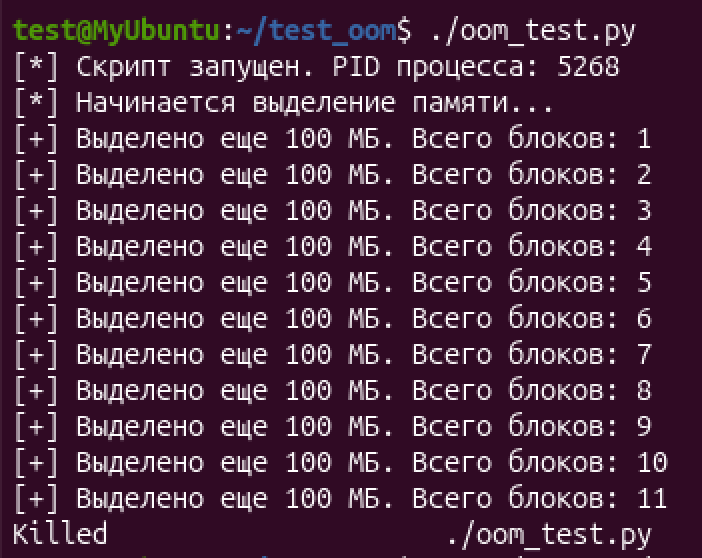
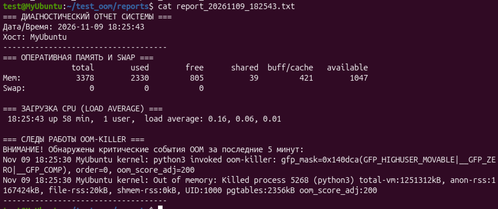
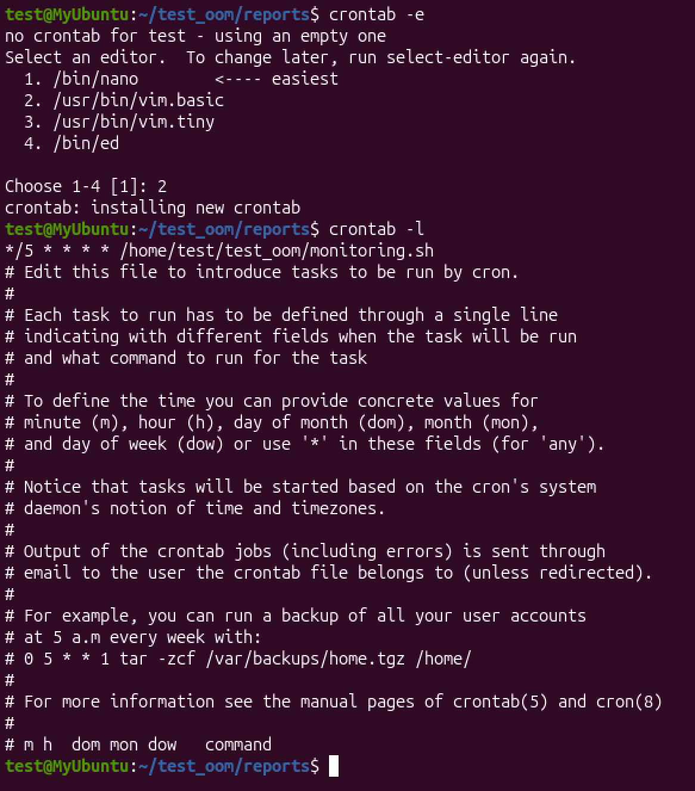
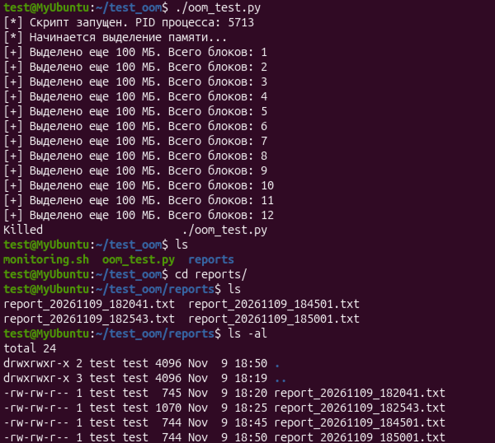
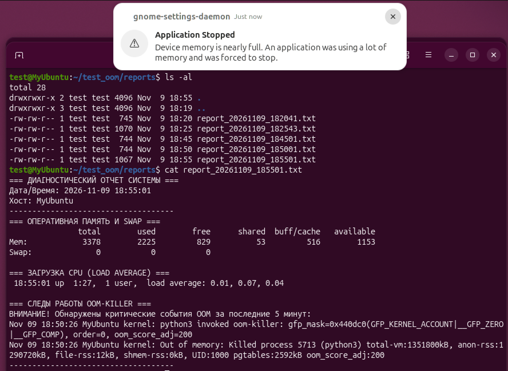

*Выполнил: Титов Евгений Вадмович*

# Задание

Среда для тестирования поведения ОС при нехватке памяти.
Вам необходимо создать изолированную среду, в которой:

1. Имитируется процесс с утечкой памяти.
2. Система автоматически (раз в пять минут) отслеживает состояние ресурсов ОС (память, загрузка CPU, использование swap) и критические события.
3. Анализируются события ядра (включая работу OOM-killer).
4. Генерируется диагностический отчёт о критических ошибках системы и об исчерпании ресурсов системы.

***Требование безопасности: вся работа проводится только в виртуальной машине (VirtualBox, VMware, QEMU и т.п.), т.к. работа ООМ-killer может привести к краху системы.***

=====================================================

# Решение задачи

## Среда исполнения
1. Хостовая машина на macOS
2. Изолированная среда ubuntu 26.04.1

3. На ВМ для проекта создана папка "test_oom", внутри директории:
- oom_test.py - скрипт, воспроизводящий ООМ
- monitoring.sh - скрипт мониторинга и генерации отчета
- /reports - директория с отчетами
4. За запуск скрипта мониторинга будет отвечать cron

```bash
mkdir /home/test/test_oom

mkdir /home/test/test_oom/reports
```


## Ход проверки
1. На каждом этапе предоставлены скриншоты
2. Срипт питона вводит в консоль PID процесса, который можно наблюдать в отчете
3. Скрипты и скриншоты приложены

## Ход выполнения
1. Скрипты перемещены в изолированную среду утилитой scp

```bash
scp -P 2222 ./monitoring.sh test@192.168.04:/home/test/test_oom/

scp -P 2222 ./oom_test.py test@192.168.04:/home/test/test_oom
```
2. Скриптам даны права на исполненние
```bash
scp -P 2222 ./monitoring.sh test@192.168.04:/home/test/test_oom/

scp -P 2222 ./oom_test.py test@192.168.04:/home/test/test_oom
```


3. Предварительный запуск скрипта monitoring.sh вручную 

```bash
./monitoring.sh

cat ./reports/report_20261109_182041.txt
```


4. Ручной запуск скрипта oom_test.py
```bash
./oom_test.py
```


5. Повторный запуск срипта monitoring.sh вручную для проверки результата 
```bash
./monitoring.sh

cat ./reports/report_20261109_182041.txt
```


6. Создание задания для планировщика
```bash
crontab -e

crontab -l
```
***При вводе "crontab -e" отобразиться выбор редактора - выберите удобный и введите \*/5 \* \* \* \* /home/test/test_oom/monitor.sh***



7. Проверяем созданную конфигурацию 
```bash
./oom_test.py

ls /reports
```



8. Ожидаем запуска cron и проверяем папку и отчет повторно

```bash
ls -al /reports

cat ./reports/report_20261109_185501.txt
```


